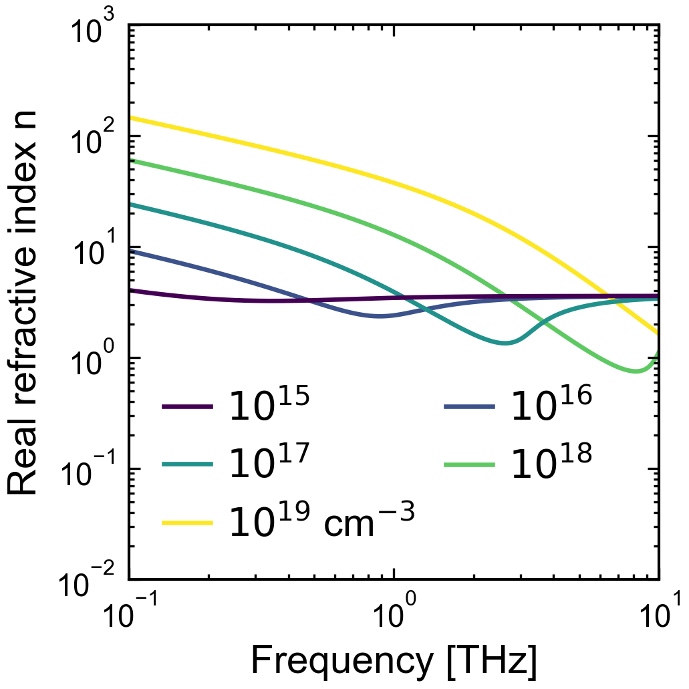
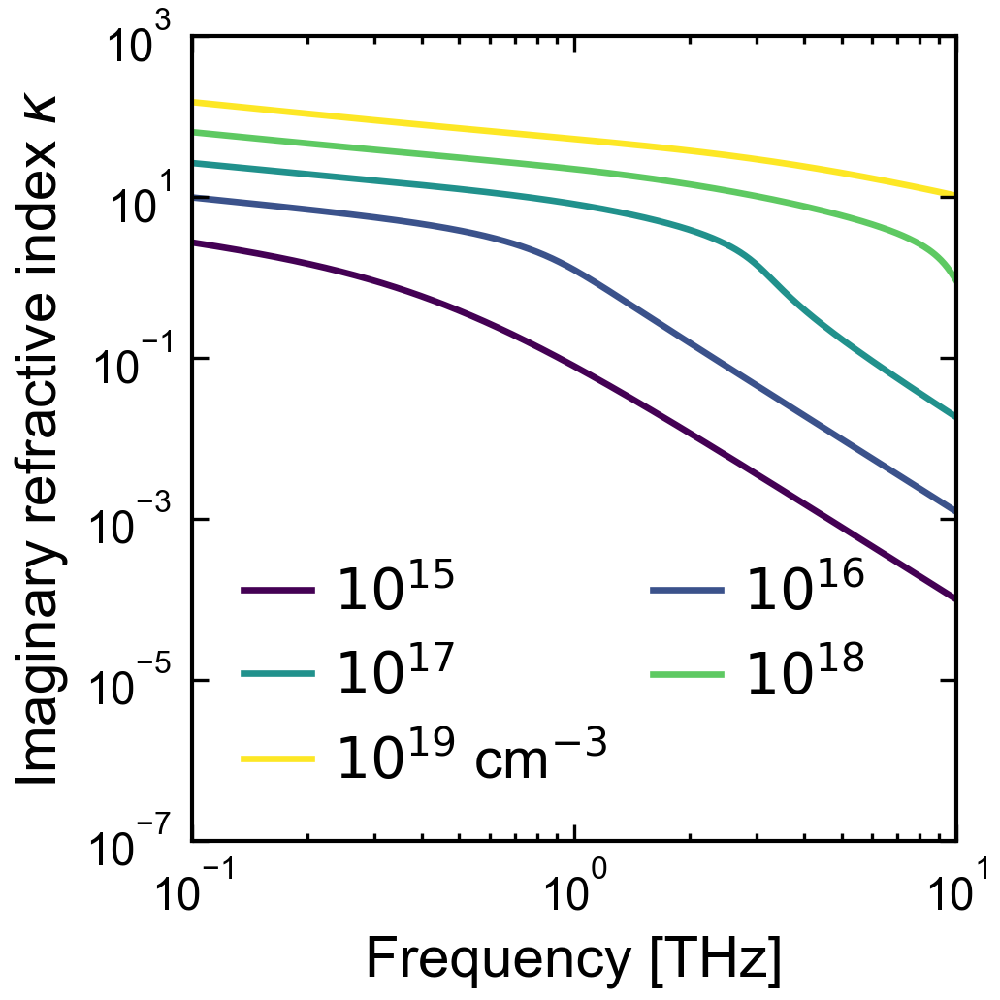
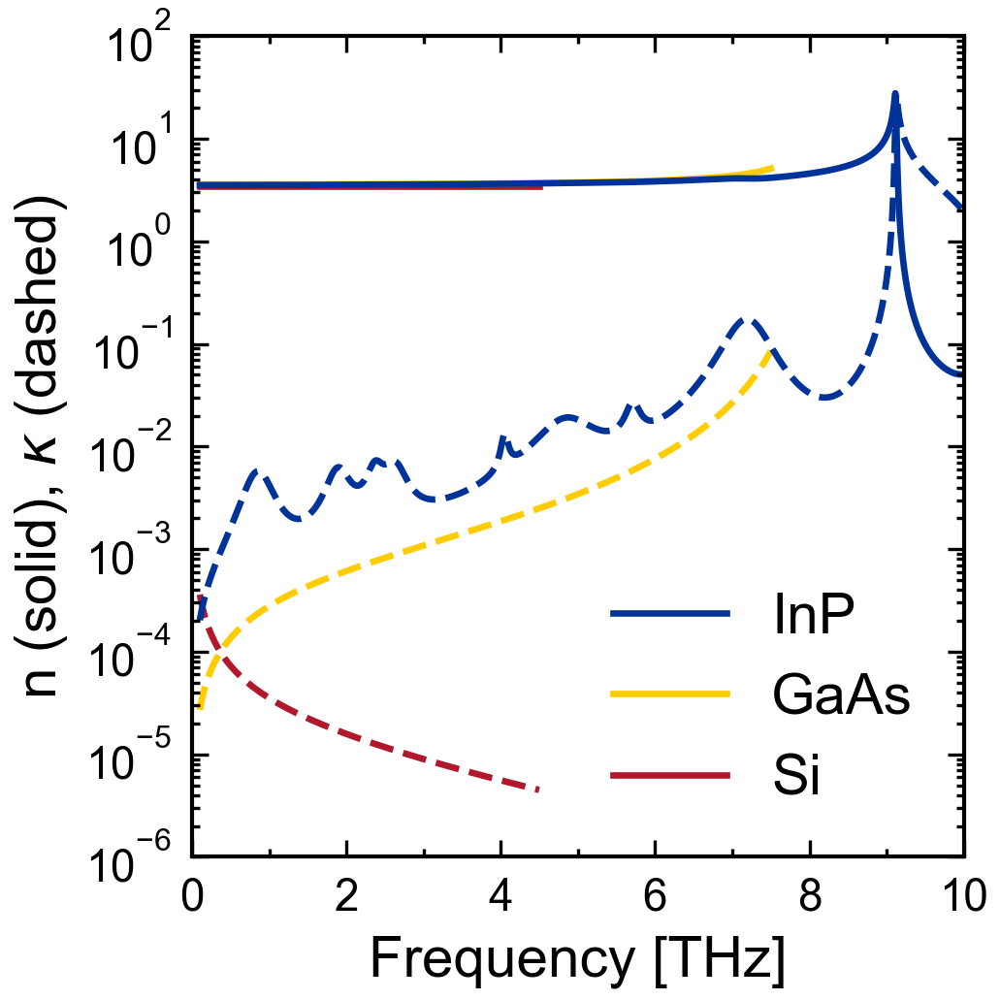
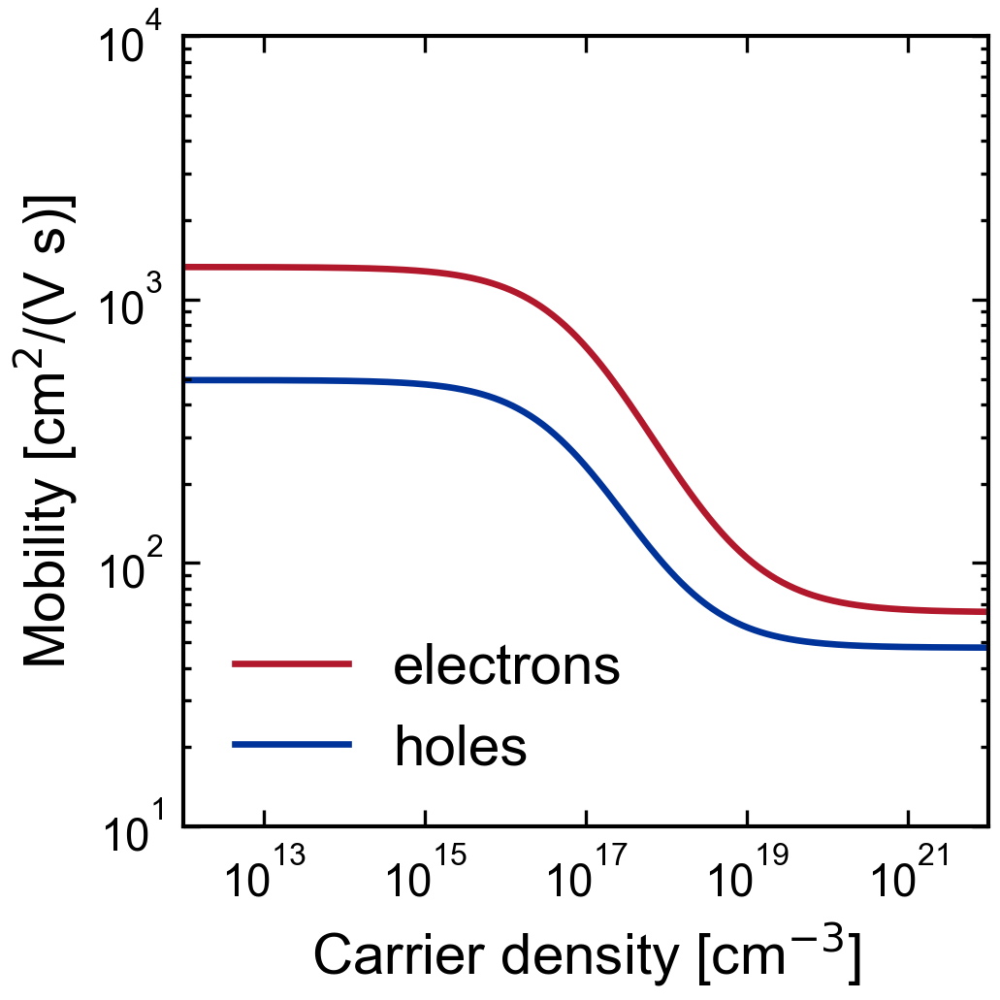
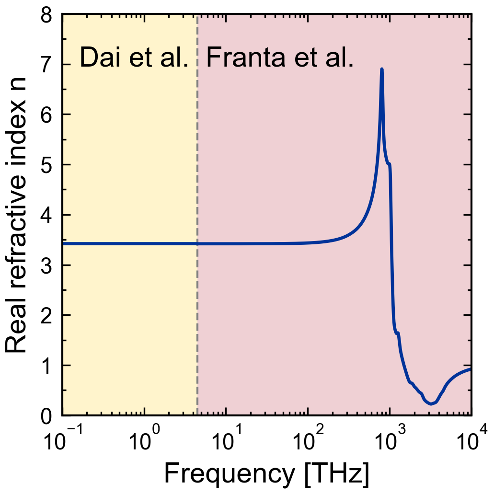
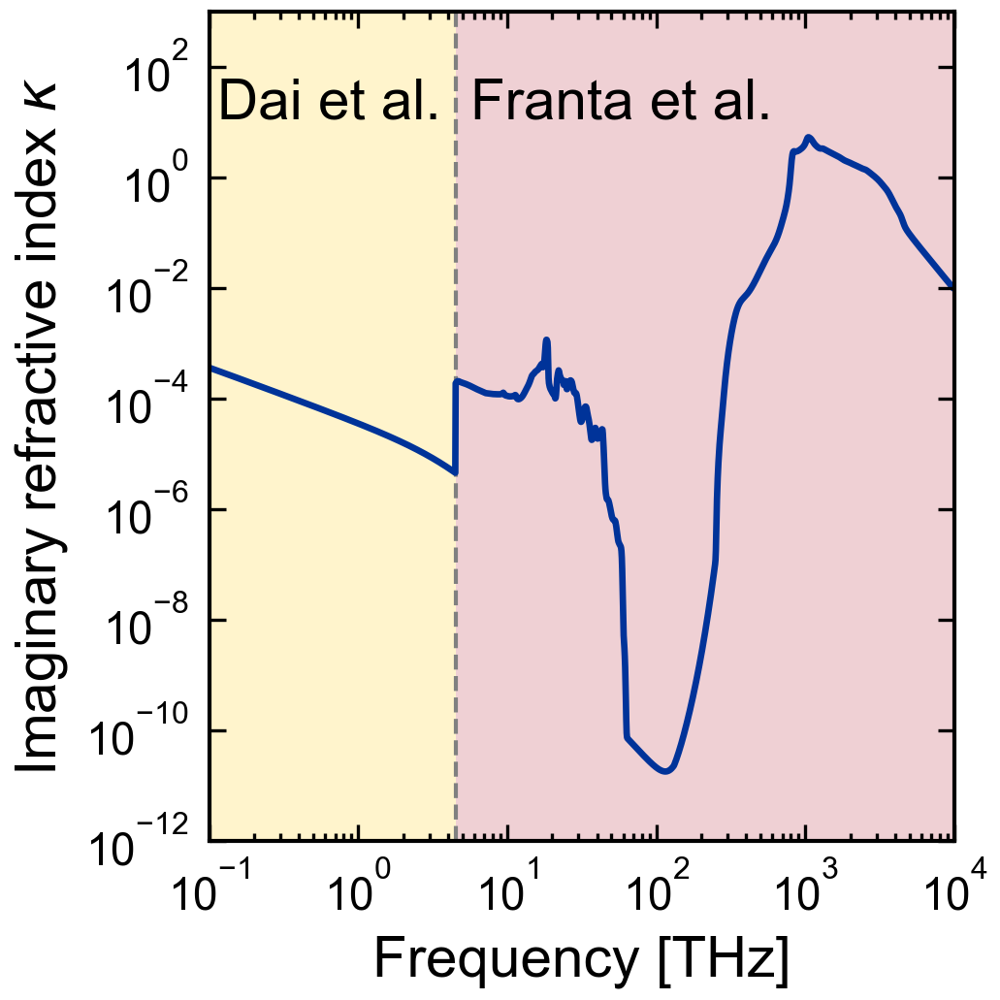

# cjcmaterials

[](https://github.com/cjcscheper/cjcmaterials/actions/workflows/tests.yml)
[](https://github.com/cjcscheper/cjcmaterials/releases)

Optical and electronic material models, and a material library in which every
value has a source you can check.

- **Models as plain functions** of the angular frequency: Drude (with a
  mobility or a scattering time, optional Drude–Smith), Lorentz oscillators,
  Drude–Lorentz, a graphene sheet, a constant index and tabulated n, κ.
- **A library of material files**, one YAML file per material, each with one
  or more *descriptions* (a THz model, an optical table, ...), a valid
  frequency range per description, and sources (DOI, ISBN or URL) with the
  table or page where the values are and whether a person has checked them.
- **Carrier density and type at use time**, not in the file: the same InP
  file describes undoped, n-type and photo-excited InP.
- **A checker**, `python -m cjcmaterials.check_library`, that lists missing
  or malformed sources, unphysical values and every source still to be
  checked by a person, and with `--online` resolves the DOIs.
- **numpy and pyyaml only.** No layer stacks, no transfer matrices, no
  fitting: combine with [cjctmm](https://github.com/cjcscheper/cjctmm) for
  multilayer optics and [cjcfit](https://github.com/cjcscheper/cjcfit) for fits.

The physics, the conventions and what the checker can and cannot verify are in
[THEORY.md](THEORY.md); the generated overview of the library is
[LIBRARY.md](LIBRARY.md).

## Install

```bash
pip install git+https://github.com/cjcscheper/cjcmaterials.git
```

To pin a fixed version, so a script keeps giving the same numbers later on
(see [Releases](https://github.com/cjcscheper/cjcmaterials/releases) and the
[changelog](CHANGELOG.md)):

```bash
pip install git+https://github.com/cjcscheper/cjcmaterials.git@v0.1.0
```

For development, clone the repository and install it editable:

```bash
pip install -e ".[test]"
```

## Quick start

```python
import numpy as np
from cjcmaterials import get_material, refractive_index, permittivity, conductivity

omega = 2 * np.pi * np.linspace(0.2e12, 3e12, 100)    # angular frequency [rad/s]
inp = get_material("InP")

n_undoped = refractive_index(inp, omega)                                       # n' + i kappa
n_doped = refractive_index(inp, omega, carrier_density=1e23, carrier_type="n") # 1e17 cm^-3 electrons [m^-3]
eps = permittivity(inp, omega, carrier_density=[1e21, 1e22, 1e23], carrier_type="p")  # shape (3, 100)
```

- `omega` in rad/s; carrier densities in m⁻³ (graphene: a sheet density in m⁻²).
- `carrier_type="n"` or `"p"` chooses the electron or hole parameters
  (effective mass, mobility) of the description; it is needed together with a
  carrier density for materials that have both.
- Several densities at once give one row per density, shape `(K, M)`, e.g.
  one per sublayer of a photo-excited depth profile.
- Time convention `exp(−iωt)`: `n = n' + iκ` with κ ≥ 0 for absorption,
  `Im ε ≥ 0`, as in cjctmm, so the result can go straight into `solve_tmm`.

`conductivity` returns the total optical conductivity `σ = −iωε₀(ε − 1)`
[S/m], defined for every description. For the free-carrier part alone, or a
graphene sheet in S, use the model functions below.

## Descriptions and valid ranges

A material has one or more descriptions, each valid in its own frequency range:

```python
si = get_material("Si")
[(d.label, d.model, d.valid_range_thz) for d in si.descriptions]
# [('thz', 'drude_lorentz', ((0.1, 4.5),)), ('optical', 'tabulated', ((0.97, 9670.0),))]
```

- By default the one description whose range covers all requested
  frequencies is used.
- If several cover them, or none does, a `ValueError` lists the descriptions
  with their ranges: which model to trust where they overlap or where none
  applies is your decision.
- `description="optical"` chooses one explicitly. Frequencies outside its
  valid range then give a `UserWarning` naming the material, the description,
  its range and its source. A table gives NaN where it has no data; nothing
  is extrapolated.

`select_description(material, omega)` returns the description that would be used.

## Model functions

Each model is a plain function that returns the relative permittivity; the
keyword names are those of the material files. They work without any file:

```python
from cjcmaterials import drude_permittivity, drude_conductivity, caughey_thomas_mobility

mobility = caughey_thomas_mobility(1e23, mu_min=0.0065, mu_max=0.1330, n_ref=8.5e22, alpha=0.72)  # Si electrons
eps = drude_permittivity(omega, eps_inf=11.7, effective_mass_ratio=0.26, carrier_density=1e23, mobility=mobility)
```

| Model name (`MODELS`) | Function                      | Parameters (SI)                                                                         |
|-----------------------|-------------------------------|-----------------------------------------------------------------------------------------|
| `constant`            | `constant_permittivity`       | `n`, `kappa=0`                                                                          |
| `drude`               | `drude_permittivity`          | `eps_inf`, `effective_mass_ratio` (m*/mₑ), `carrier_density=0`, `mobility` or `scattering_time`, `smith_c=None` |
| `lorentz`             | `lorentz_permittivity`        | `eps_inf`, `oscillators` (each `strength`, `resonance_omega`, `damping` in rad/s)       |
| `drude_lorentz`       | `drude_lorentz_permittivity`  | the Lorentz and Drude parameters, one shared `eps_inf`                                  |
| `graphene_sheet`      | `graphene_sheet_permittivity` | `carrier_density` [m⁻²], `mobility`, `thickness`, `eps_inf=1`, `temperature=300`, `fermi_velocity=1e6` |
| `tabulated`           | `tabulated_permittivity`      | `file` (n, κ table, see below)                                                          |

Also available: `drude_conductivity`, `graphene_sheet_conductivity` (in S),
`plasma_omega`, `scattering_time_from_mobility`, `caughey_thomas_mobility`
(`MOBILITY_MODELS`), `tabulated_refractive_index` and `read_nk_table`, and the
constants `SPEED_OF_LIGHT`, `VACUUM_PERMITTIVITY`, `ELEMENTARY_CHARGE`,
`ELECTRON_MASS`, `REDUCED_PLANCK_CONSTANT`, `BOLTZMANN_CONSTANT`.

## The library

```python
from cjcmaterials import available_materials
available_materials()
# ['air', 'Al', 'Be', 'Cr', 'GaAs', 'GaN', 'Graphene', 'In053Ga047As', 'InP', 'Ni', 'Pd', 'Pt', 'Si', 'SiN', 'SiO2', 'Ti', 'W']
```

[LIBRARY.md](LIBRARY.md) lists every description with its model, range and
sources. **Most sources have not been checked by a person yet** (`checked: no`);
run the checker to see which.

### Your own materials

Put your own `<name>.yaml` files (and tables) in a folder and pass it:

```python
get_material("MyGlass", folders="my_materials")             # extends the library
get_material("InP", folders=["my_materials", "shared"])      # a file there replaces the bundled InP
available_materials(folders="my_materials")
```

Your folders are searched first, in order, then the bundled library.

### A material file

To start a new one, copy [`material_template.yaml`](material_template.yaml)
from the repository root: it shows every field, with comments, for the
constant, Drude, Drude–Lorentz and tabulated models, and it passes the checker
as it is. In short (from `InP.yaml`):

```yaml
name: InP                                   # = file name without .yaml
note: Indium phosphide at room temperature.
sources:
  alyabyeva2017:                            # a key, referred to below
    type: doi                               # doi | isbn | url
    id: 10.1038/s41598-017-07164-1
    citation: L. N. Alyabyeva et al., Dielectric properties of semi-insulating Fe-doped InP ..., Sci. Rep. 7, 7360 (2017)
    location: Table 1                       # where the values are
    valid_range_thz: [[0.06, 21]]           # where they apply [THz]
    checked: no                             # after checking: "J. Doe, 2026-11-02"
  sotoodeh2000: {...}
descriptions:
  - label: thz
    model: drude_lorentz
    valid_range_thz: [[0.06, 21]]
    sources: [alyabyeva2017]                # for the description and every parameter without its own source
    parameters:                             # SI units, the keyword arguments of the model function
      eps_inf: {value: 9.61, source: levinshtein1996}      # a parameter with its own source
      oscillators:
        - {strength: 2.714, resonance_omega: 5.730e13, damping: 1.32e11}
      electrons:                            # chosen with carrier_type="n"
        effective_mass_ratio: {value: 0.075, source: bennett1990}
        mobility: {model: caughey_thomas, mu_min: 0.04, mu_max: 0.52, n_ref: 3.0e23, alpha: 0.47, source: sotoodeh2000}
      holes: {...}                          # chosen with carrier_type="p"
  - label: optical
    model: tabulated
    valid_range_thz: [[308, 1498]]
    sources: [glembocki1985]
    parameters:
      file: InP_Glembocki1985.csv           # next to the YAML file
```

- `mobility` is a number [m²/(V s)] or a mobility model evaluated at the
  carrier density of the call.
- A file may give a `carrier_density` where it is a material constant (a
  metal, see `Al.yaml`); a density passed at use time replaces it.
- Tables use the CSV export format of
  [refractiveindex.info](https://refractiveindex.info): optional `#` comment
  lines, a `wl,n` block and a `wl,k` block of `wavelength_um,value` rows.

## Checking the library

```bash
python -m cjcmaterials.check_library                      # the bundled library (and LIBRARY.md)
python -m cjcmaterials.check_library my_materials         # your own folder
python -m cjcmaterials.check_library --online             # also resolve DOIs and compare their metadata
python -m cjcmaterials.check_library --write-overview     # regenerate LIBRARY.md
python -m cjcmaterials.check_library --require-checked    # fail while any source is unchecked
```

The problems are grouped by rule (loading, completeness, identifiers, valid
ranges, physical sanity, overview, online), followed by the list of sources
still to be checked by a person. The exit code is 0 when everything passes,
1 otherwise. The same check is available as `check_library(folders)`,
returning a `LibraryCheck`. THEORY.md explains each rule and its limits.

## Examples

Each script in `examples/` saves its figures next to itself. They plot with
[cjcplot](https://github.com/cjcscheper/cjcplot), which cjcmaterials itself
does not need. Install both with the `examples` extra:

```bash
pip install "cjcmaterials[examples] @ git+https://github.com/cjcscheper/cjcmaterials.git"
```

or, in a clone, `pip install -e ".[examples]"`. The extra pins cjcplot to a
release tag (now `v0.2.0`), so the figures keep looking the same when cjcplot
changes.

<!-- widths = fig_aspect_ratio[0] x 640 px, so all fonts appear at the same size. -->

### Drude model in the THz range

`example_drude_thz.py`: n and κ of electrons in GaAs (effective mass and
Caughey–Thomas mobility from the GaAs file, phonon left out) for carrier
densities from 10¹⁵ to 10¹⁹ cm⁻³. More carriers push the plasma frequency up;
below it κ dominates, just above it n dips.

<table align="center">
  <tr>
    <td></td>
    <td></td>
  </tr>
</table>

### Semiconductors from the library

`example_semiconductors_thz.py`: undoped InP, GaAs and Si, each in the
range of its THz description. The TO phonon of InP (9.1 THz) shows as a
swing in n and a peak in κ; GaAs stops at 7.5 THz, below its phonon at 8.0 THz.

<p align="center">
  
</p>

### Caughey–Thomas mobility of silicon

`example_caughey_thomas_silicon.py`: electron and hole mobility versus
carrier density, with the parameters from the silicon file (electrons red,
holes blue).

<p align="center">
  
</p>

### Valid ranges

`example_valid_ranges.py`: n and κ of silicon from its two descriptions, Dai
et al. (THz model, up to 4.5 THz) and Franta et al. (table, above). Between
0.97 and 4.5 THz both are valid, so the script chooses with `description=`;
the step in κ at the border shows how much the two sources differ there. The
script also prints the warning for the table below its range.

<table align="center">
  <tr>
    <td></td>
    <td></td>
  </tr>
</table>

## License

MIT, see [LICENSE](LICENSE).
